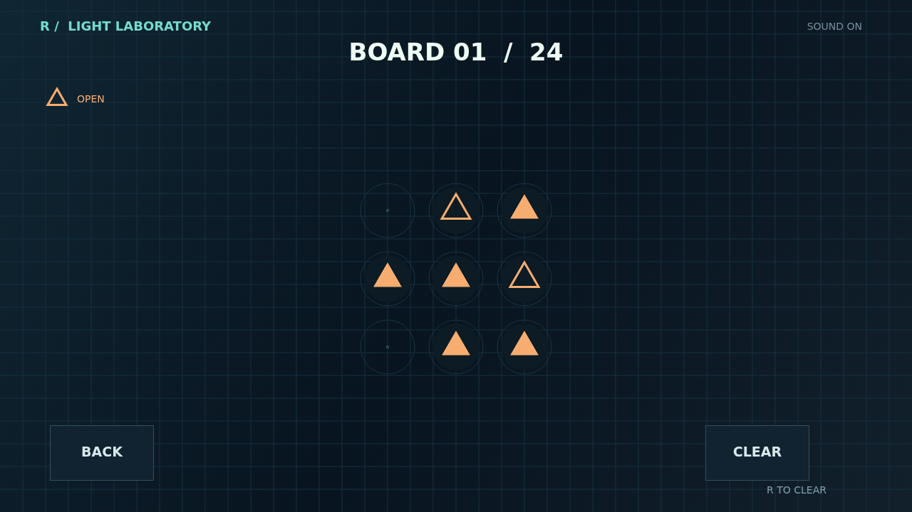

# Refract

Draw light across a dark optical bench. Press on an outlined emitter and trace a beam from node to node, all the way to its matching partner. Let go at any point to leave your path in place, then pick it up again from either end.

Every filled lens of the same shape must be threaded. Crystals can carry any color, but each has a charge count that must be spent exactly. The route can bend through neighboring nodes, including diagonals, so every new segment changes the possibilities ahead.

Campaign leads you through 24 carefully arranged boards, opening the next when you solve one. Cascade keeps generating new puzzles and climbs through five tiers as your solved count grows.

